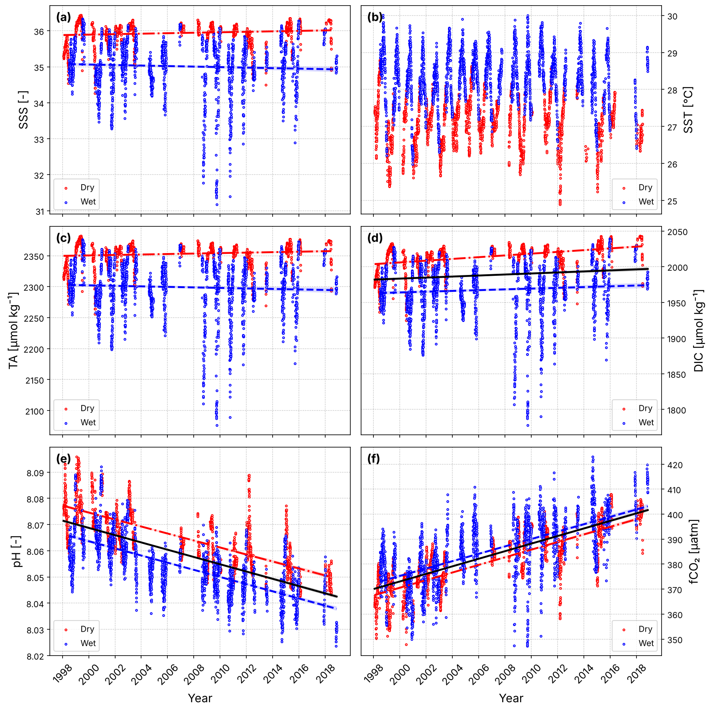
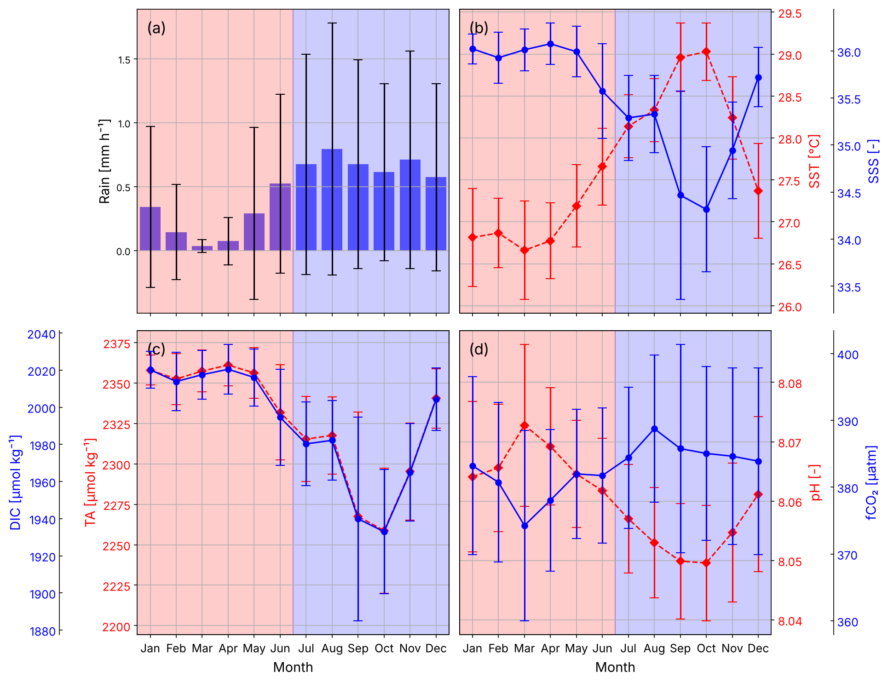

# Marine carbonate system at the PIRATA buoy 8°N 38°W (1998–2018)

Code to reproduce the figures and statistics of:

> de Assis, C. A. M., Pinho, L. Q., Fernandes, A. M., Araujo, M., & Cotrim da Cunha, L. (2024).
> **Reconstruction of the marine carbonate system at the Western Tropical Atlantic: trends and variabilities from 20 years of the PIRATA program.**
> *Frontiers in Marine Science*, 11, 1286960. https://doi.org/10.3389/fmars.2024.1286960


*Daily values in the dry (red) and wet (blue) seasons. Lines show significant trends (p < 0.05): dry (dash-dot), wet (dashed) and all data (solid).*

## What the study does

Total alkalinity (TA) and dissolved inorganic carbon (DIC) are estimated from 20 years of daily sea surface salinity (SSS) at the PIRATA mooring at 8°N 38°W, using regional empirical relationships. pH and CO₂ fugacity (fCO₂) are then calculated with **PyCO2SYS**. The reconstructed series is validated against GLODAP and SOCAT, and analysed for seasonality and long-term trends.

**Main results**

- fCO₂ increases (≈1.5 µatm yr⁻¹) and pH decreases over 1998–2018. DIC's increase disappears once the seasonal cycle is removed.
- There is a clear dry season (January–June) and wet season (July–December), driven by freshwater input.
- TA, DIC and pH follow SSS; fCO₂ follows SST.
- The TA−DIC difference decreases, which points to a weakening surface buffer capacity.



## Methods in code

| Step | Implementation |
|---|---|
| TA | `58.1 × SSS + 265` (Lefèvre et al., 2010) |
| DIC | `50.1 × SSS + 198 + 0.9 × (year − 1989)` (Bonou et al., 2016) |
| pH, fCO₂, xCO₂ | PyCO2SYS 1.8.2, Millero (2006) constants, total pH scale |
| Uncertainty | propagated from TA (±11.6) and DIC (±24 µmol kg⁻¹) |
| Normalisation | to the mean SSS (35.42) with a non-zero freshwater end-member (Friis et al., 2003) |
| Trends | least squares + Mann-Kendall, for all data and per season |
| De-seasoning | monthly-climatology anomalies (Sutton et al., 2022) |
| Comparisons | Wilcoxon-Mann-Whitney tests vs GLODAPv2.2022 and SOCATv2023 |

## Repository structure

```
├── make_figures.py        # reproduces Figures 1–10 and S1–S4
├── make_tables.py         # statistics used in the paper -> results/*.csv
├── pirata/
│   ├── config.py          # constants, file names, labels
│   ├── io.py              # loaders for buoy, GLODAP, SOCAT, Barbados xCO2
│   ├── carbonate.py       # TA/DIC estimation, PyCO2SYS, normalisation
│   ├── stats.py           # trends, Mann-Whitney, de-seasoning
│   └── figures.py         # one function per figure
├── data/                  # input files (see data/README.md)
├── figures/               # generated figures (PNG, 200 dpi)
└── results/               # generated tables (CSV)
```

## Figures

| # | Content | Function |
|---|---|---|
| 1 | Study area: buoy, GLODAP and SOCAT data, currents, ITCZ | `fig01_map` |
| 2 | Sea-surface vs atmospheric xCO₂ (Ragged Point, Barbados) | `fig02_atmosphere` |
| 3 | Monthly climatology of rain, SSS/SST, TA/DIC, pH/fCO₂ | `fig03_climatology` |
| 4 | TA, DIC and pH vs GLODAP | `fig04_glodap` |
| 5 | fCO₂ vs SOCAT and CARIOCA: series, difference, 1:1 plot | `fig05_socat` |
| 6 | Time series by season with significant trends | `fig06_timeseries` |
| 7 | De-seasoned pH and fCO₂ trends | `fig07_deseasoned` |
| 8 | Salinity-normalised TA, DIC, pH, fCO₂ | `fig08_normalized` |
| 9 | Daily heatmaps (year × day of year) | `fig09_heatmaps` |
| 10 | DIC/TA ratio and TA−DIC | `fig10_buffer` |
| S1–S4 | Data coverage, raw vs daily means, annual means, anomalies | `figS1`–`figS4` |

## How to run

```bash
pip install -r requirements.txt
python make_figures.py              # all figures -> figures/
python make_figures.py --only 6 7   # selected figures
python make_tables.py               # statistics -> results/
```

Figure 1 uses Cartopy, which downloads Natural Earth coastlines the first time it runs, so it needs an internet connection.

## Reproducibility check

Values from the paper compared with what `make_tables.py` gives on the original input files:

| Quantity | Paper | This code |
|---|---|---|
| SSS trend (yr⁻¹) | −0.0036 ± 0.0021 | −0.0036 ± 0.0021 |
| SST trend (°C yr⁻¹) | 0.0039 ± 0.0023 | 0.0039 ± 0.0023 |
| TA trend (µmol kg⁻¹ yr⁻¹) | −0.209 ± 0.124 | −0.209 ± 0.124 |
| DIC trend (µmol kg⁻¹ yr⁻¹) | 0.717 ± 0.108 | 0.717 ± 0.108 |
| pH trend (yr⁻¹) | −0.0014 ± 0.0001 | −0.00139 ± 0.00003 |
| fCO₂ trend (µatm yr⁻¹) | 1.515 ± 0.025 | 1.515 ± 0.025 |
| Normalised DIC trend | 0.897 | 0.897 |
| Uncertainty pH / fCO₂ | 0.041 / 45.00 µatm | 0.041 / 44.96 µatm |
| De-seasoned pH trend (R²) | −0.0014 (0.725) | −0.0014 (0.718) |
| De-seasoned fCO₂ trend (R²) | 1.633 ± 0.091 (0.69) | 1.567 ± 0.089 (0.68) |
| Atmospheric xCO₂ trend, Barbados | 1.908 ± 0.010 ppm yr⁻¹ | 1.947 ± 0.009 ppm yr⁻¹ |

Every trend computed directly from the daily data matches the paper. Two values differ:

- **De-seasoned trends.** The paper's de-seasoned series came from a separate step that is not part of these scripts. This code uses monthly-climatology anomalies, which give the same pH trend and a slightly lower fCO₂ trend. With this method, the de-seasoned DIC trend is still significant (0.95 ± 0.26 µmol kg⁻¹ yr⁻¹, p < 0.001), while the paper reports no DIC trend after de-seasoning. If you have the original `pH_deseasoned_monthly_means.csv` and `fCO2_deseasoned_monthly_means.csv`, put them in `data/` and Figure 7 will use them.
- **Barbados xCO₂.** The Barbados file used here runs to December 2021. Using the data up to 2019 gives 1.911 ± 0.010 ppm yr⁻¹, so the paper's value most likely came from an earlier download of the same record.

## Data

See [`data/README.md`](data/README.md) for the expected files and where to download them. The sources are the PIRATA buoy (NOAA PMEL), GLODAPv2.2022, SOCATv2023 and NOAA GML flask xCO₂ at Ragged Point, Barbados.

## Notes on the refactoring

This code is a cleaned-up version of the analysis scripts used for the paper:

- The 17 original scripts repeated the same loading and PyCO2SYS block. That block now lives once in `pirata/`, and each figure is a function.
- Seasons follow the paper everywhere (dry = Jan–Jun, wet = Jul–Dec). A few exploratory scripts still used April–September; this only affects the supplementary anomaly figure.
- De-seasoned monthly means are computed in `stats.deseasoned_monthly_means` instead of being read from intermediate CSV files.
- File header lengths are detected automatically instead of being hard-coded.

## Citation

If you use this code, please cite the paper above.
